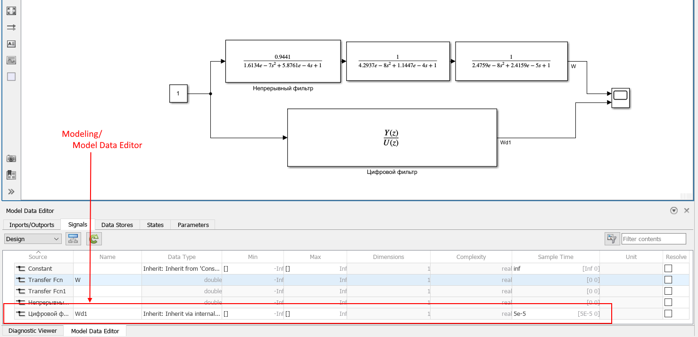
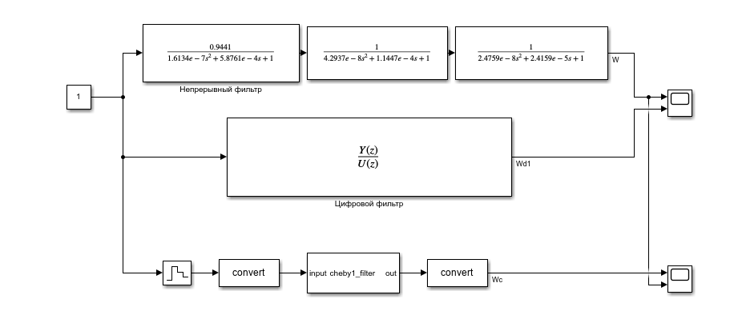
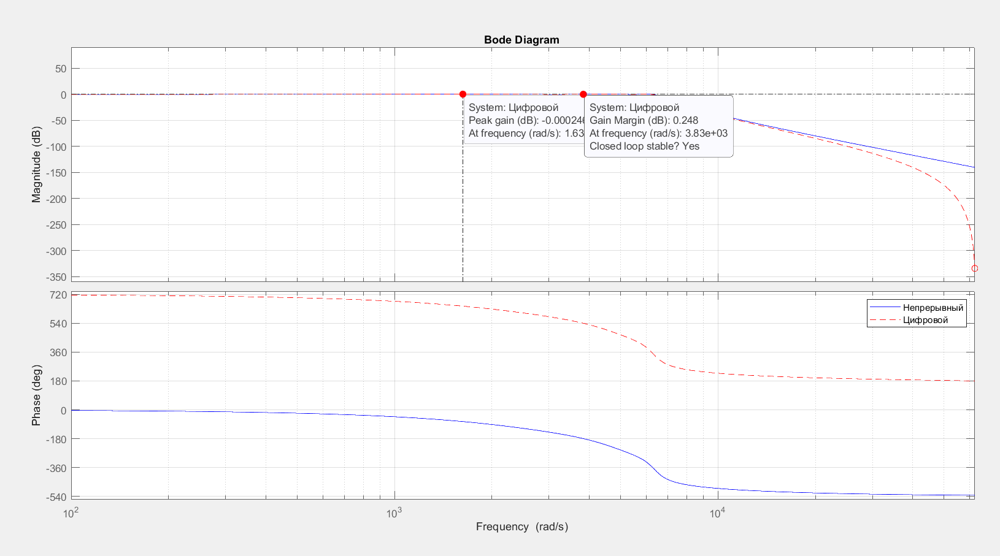
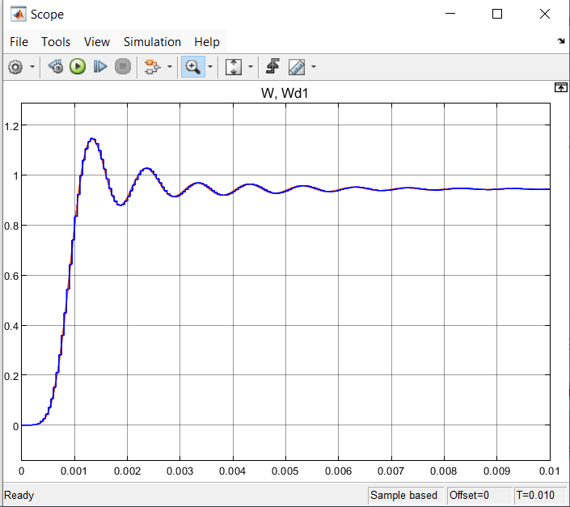
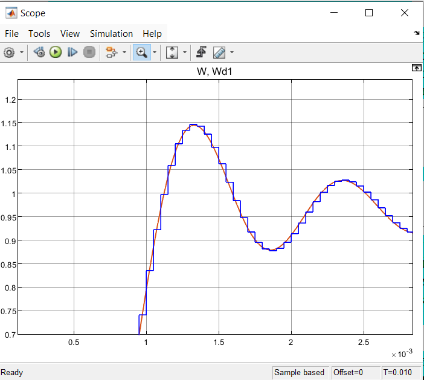
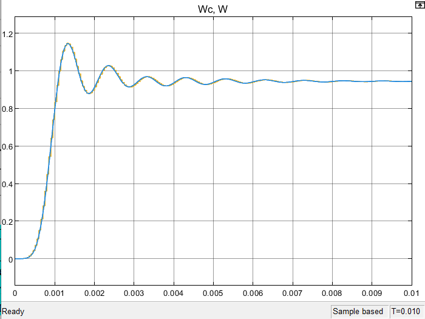
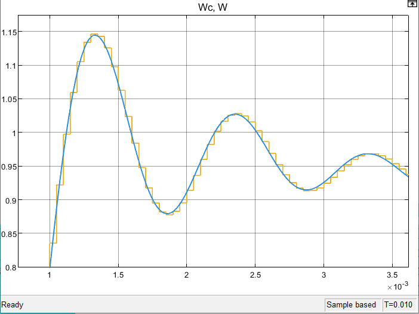

# Курсовая работа: цифровой фильтр Чебышёва I рода

Реализация фильтра нижних частот Чебышёва I рода (вариант 3) в виде цифрового корректирующего устройства с периодом квантования 50 мкс. Передаточная функция разбита на три звена второго порядка, дискретизирована билинейным преобразованием, проверена в MATLAB и Simulink и записана функцией на Си (`float`), которую вызывает прерывание таймера на STM32G474RE: АЦП → фильтр → ЦАП.

Пояснения к коду и расчёту даны в главе 5 методички. Номера рисунков ниже совпадают с её нумерацией.

## Задание варианта 3

| Параметр                               | Значение                                              |
| -------------------------------------- | ----------------------------------------------------- |
| Фильтр                                 | нижних частот, Чебышёва I рода                        |
| Порядок                                | 6                                                     |
| Неравномерность в полосе пропускания   | 0,5 дБ                                                |
| Частота среза                          | 1000 Гц                                               |
| Период квантования T                   | 5·10⁻⁵ с (20 кГц, частота Найквиста 10 кГц)           |
| Числа в программе МК                   | `float`, одинарная точность                           |

Требуется: передаточная функция непрерывного фильтра W, цифровой фильтр Wd1 (в Simulink), цифровой фильтр Wd2 (функция на Си), сравнение их частотных характеристик (фаза цифрового фильтра по w-преобразованию), программа для микроконтроллера.

Непрерывный фильтр записан как произведение трёх звеньев, W = W1·W2·W3:

- W1 = 0,9441 / (1,6134·10⁻⁷·s² + 5,8761·10⁻⁴·s + 1)
- W2 = 1 / (4,2937·10⁻⁸·s² + 1,1447·10⁻⁴·s + 1)
- W3 = 1 / (2,4759·10⁻⁸·s² + 2,4159·10⁻⁵·s + 1)

Множитель K = 10^(−0,5/20) = 0,9441 стоит в первом звене: на нулевой частоте усиление фильтра равно K, а не 1.

## Файлы

| Файл                | Что в нём                                                                                                                         | Куда положить                |
| ------------------- | --------------------------------------------------------------------------------------------------------------------------------- | ---------------------------- |
| `cheby1_filter.c`   | функция `cheby1_filter`: каскад из трёх звеньев, коэффициенты, ячейки памяти. От HAL не зависит, поэтому её же вызывает Simulink  | проект CubeIDE, `Core/Src`   |
| `cheby1_filter.h`   | объявление функции                                                                                                                | проект CubeIDE, `Core/Inc`   |
| `main.c`            | проект CubeIDE; код курсовой в блоках `Includes`, `USER CODE 0` (переменные и обработчик таймера), `USER CODE 2` (запуск)         | это файл проекта             |
| `filters.m`         | MATLAB: звенья W1, W2, W3, дискретизация, ЛАЧХ и ЛФЧХ, числа `num` и `den` для Simulink                                           | рядом с `sheme.slx`          |
| `sheme.slx`         | модель Simulink: фильтры W и Wd1, функция на Си через блок C Caller                                                               | рядом с `cheby1_filter.c`    |
| `images/`           | рисунки к этому описанию (из методички)                                                                                           |                              |

Папка `slprj/` и файл `sheme.slxc` создаются Simulink сами (кэш сборки), кода курсовой не содержат и в репозитории не нужны. Остальные файлы проекта CubeIDE (`system_stm32g4xx.c`, `stm32g4xx_it.c` и другие) создаются средой и в этой работе не менялись.

## Что делает программа

1. TIM2 вызывает прерывание каждые 50 мкс (20 кГц).
2. В обработчике `HAL_TIM_PeriodElapsedCallback` запускается одно преобразование АЦП1 (12 бит, программный запуск), код переводится в вольты: `filter_in = raw · 3,3 / 4095`.
3. `cheby1_filter(filter_in)` делает один шаг фильтра: 15 умножений и 12 сложений. Из 8500 тактов периода (170 МГц · 50 мкс) это сотни тактов.
4. Результат `filter_out` ограничивается диапазоном 0…3,3 В, переводится в код ЦАП с округлением и выводится на DAC1 OUT1.
5. Переменные `filter_in` и `filter_out` объявлены `volatile`, их можно смотреть в SWV.

Каждое звено считается по двум уравнениям, выход звена идёт на вход следующего:

`v[n] = x[n] − a1·v[n−1] − a2·v[n−2]`

`y[n] = b0·v[n] + b1·v[n−1] + b2·v[n−2]`

Коэффициенты получены билинейным преобразованием `s = (2/T)·(1 − z⁻¹)/(1 + z⁻¹)`. Для звена K/(A·s² + B·s + 1) при c = 2/T и D = A·c² + B·c + 1:

`b0 = b2 = K/D`, `b1 = 2K/D`, `a1 = 2(1 − A·c²)/D`, `a2 = (A·c² − B·c + 1)/D`.

| Звено | b0 = b2       | b1            | a1          | a2         |
| ----- | ------------- | ------------- | ----------- | ---------- |
| 1     | 0,0033401923  | 0,0066803845  | −1,8195327  | 0,83368454 |
| 2     | 0,013462937   | 0,026925873   | −1,8228601  | 0,87671181 |
| 3     | 0,024049584   | 0,048099169   | −1,8573205  | 0,95351889 |

Каскад звеньев выбран вместо одного многочлена шестой степени: в одинарной точности коэффициенты многочлена теряют точность, а у каскада каждое звено считается отдельно. Все константы в коде записаны с суффиксом `f`, иначе компилятор считает в двойной точности, а FPU Cortex-M4F в STM32G4 работает только с одинарной.

## Настройки CubeMX

| Что                                        | Значение                                                                             |
| ------------------------------------------ | ------------------------------------------------------------------------------------ |
| Плата                                      | Nucleo на STM32G474RE (Board Selector); для другой платы следите за частотой и выводами |
| Тактирование                               | HSI → PLL (M = 4, N = 85, R = 2), SYSCLK 170 МГц                                     |
| TIM2, Clock Source                         | Internal Clock                                                                       |
| TIM2, Prescaler                            | 16                                                                                   |
| TIM2, Counter Period (ARR)                 | 499                                                                                  |
| TIM2, NVIC                                 | включить TIM2 global interrupt                                                       |
| ADC1, канал                                | IN1, Single-ended (вывод PA0)                                                        |
| ADC1, Resolution                           | 12 bits                                                                              |
| ADC1, Continuous Conversion Mode           | Disabled                                                                             |
| ADC1, External Trigger Conversion Source   | Regular Conversion launched by software                                              |
| DAC1, канал                                | OUT1, выведен на внешний контакт (вывод PA4)                                         |
| DAC1, Output Buffer                        | Enable                                                                               |
| DAC1, Trigger                              | None                                                                                 |

Остальное оставьте по умолчанию. Частота таймера: 170 МГц / ((16 + 1) · (499 + 1)) = 20 кГц. Другие пары (PSC, ARR) тоже подойдут, если произведение (PSC + 1)(ARR + 1) равно 8500.

## Куда вставить код

Копируйте в `main.c` только содержимое блоков `USER CODE`, а не весь файл: остальное создаёт CubeMX. Сначала положите `cheby1_filter.c` в `Core/Src`, а `cheby1_filter.h` в `Core/Inc` (в CubeIDE их можно перетащить в Project Explorer).

Подключение заголовка:

```c
/* USER CODE BEGIN Includes */
#include "cheby1_filter.h"
/* USER CODE END Includes */
```

Переменные и обработчик таймера:

```c
/* USER CODE BEGIN 0 */
volatile float filter_in;   /* вход фильтра, В */
volatile float filter_out;  /* выход фильтра, В */

void HAL_TIM_PeriodElapsedCallback(TIM_HandleTypeDef *htim)
{
    if (htim->Instance != TIM2) return;     /* колбэк общий для таймеров */

    HAL_ADC_Start(&hadc1);                  /* 1. читаем АЦП */
    HAL_ADC_PollForConversion(&hadc1, 1);
    uint32_t raw = HAL_ADC_GetValue(&hadc1);

    filter_in = raw * (3.3f / 4095.0f);     /* код АЦП в вольты */
    filter_out = cheby1_filter(filter_in);  /* 2. шаг фильтра */

    float y = filter_out;                   /* 3. выводим на ЦАП */
    if (y < 0.0f) y = 0.0f;                 /* ограничение до приведения к целому */
    if (y > 3.3f) y = 3.3f;
    uint32_t dac = (uint32_t)(y * (4095.0f / 3.3f) + 0.5f);
    HAL_DAC_SetValue(&hdac1, DAC_CHANNEL_1, DAC_ALIGN_12B_R, dac);
}
/* USER CODE END 0 */
```

Запуск, один раз в `main` перед главным циклом:

```c
/* USER CODE BEGIN 2 */
HAL_ADCEx_Calibration_Start(&hadc1, ADC_SINGLE_ENDED);  /* калибровка АЦП */
HAL_DAC_Start(&hdac1, DAC_CHANNEL_1);                   /* запуск ЦАП */
HAL_TIM_Base_Start_IT(&htim2);                          /* таймер с прерываниями */
/* USER CODE END 2 */
```

Почему так:

- Ограничение до приведения к `uint32_t` обязательно: приведение отрицательного `float` к беззнаковому целому в Си не определено.
- `+ 0.5f` даёт округление к ближайшему целому, а не отбрасывание дробной части.
- `HAL_DAC_Start` вызывается один раз в `main`, не в обработчике: обработчик занимается только данными.
- Проверка `htim->Instance != TIM2` нужна, потому что колбэк общий для всех таймеров проекта.

## Что куда подключать

| Сигнал                                         | Вывод МК | Контакт на Nucleo-G474RE |
| ---------------------------------------------- | -------- | ------------------------ |
| Вход фильтра: генератор, он же канал 1 осциллографа | PA0 (ADC1_IN1) | A0, разъём CN8, контакт 1 |
| Выход фильтра: канал 2 осциллографа            | PA4 (DAC1_OUT1) | A2, разъём CN8, контакт 3 |
| Общий провод генератора и осциллографа         | GND      | GND, разъём CN6, контакт 6 или 7 |

```
Генератор ─────┬─────────────► A0 (PA0)   вход АЦП
               └─► осциллограф, канал 1
                               Nucleo-G474RE
Осциллограф, канал 2 ◄──────── A2 (PA4)   выход ЦАП
Общий провод ───────────────── GND (CN6)
```

Соответствие контактов взято из [руководства пользователя UM2505](https://www.st.com/resource/en/user_manual/um2505-stm32g4-nucleo64-boards-mb1367-stmicroelectronics.pdf) (таблица разъёма CN8). Если выбрали другой канал АЦП, подключайте к выводу, который CubeMX назначил этому каналу.

Требования к входному сигналу:

- Напряжение на входе АЦП должно быть в пределах 0…3,3 В. Отрицательное напряжение и напряжение выше 3,3 В подавать нельзя: это может повредить вход.
- На ступеньке вверх выход фильтра выбрасывает до 1,15 от размаха ступеньки и может выйти за 3,3 В, а на ступеньке вниз уходит ниже установившегося значения и может стать отрицательным. ЦАП не выдаёт напряжение вне 0…3,3 В, программа ограничивает выход, и вместо выброса получается «полка».
- Поэтому прямоугольный сигнал берите не от 0 В, а, например, с нижним уровнем 0,6 В и верхним 2,8 В (размах 2,2 В, смещение 1,7 В). Расчёт на компьютере для такого сигнала даёт выход от 0,12 до 3,09 В, то есть без ограничения. При нижнем уровне 0 В расчётный выброс вниз доходит до −0,57 В и на осциллографе после спада будет срезан по нулю.
- Установившийся выход равен 0,9441 от входа: при уровнях 0,6 и 2,8 В выход выйдет на 0,57 и 2,64 В.
- Для переходного процесса частоту прямоугольного сигнала берите такой, чтобы полупериод был заметно больше времени установления (около 10 мс), например 20–50 Гц.
- Уровни на выходе генератора проверьте осциллографом до подключения к плате. Генератор с выходом 50 Ом при высокоомной нагрузке даёт напряжение вдвое больше установленного.

После запуска в первые 10–15 мс на выходе виден переходный процесс: фильтр «заряжается» от нулевых начальных условий. Это не ошибка.

## Просмотр сигналов в SWV

1. Run → Debug Configuration → Debugger: включить Serial Wire Viewer, Core Clock 170 МГц.
2. Window → Show View → SWV → SWV Data Trace Timeline Graph.
3. Configure Trace: добавить `filter_in` и `filter_out`, запустить трассировку и продолжить выполнение.

Канал SWO ограничен по скорости, а переменные меняются 20 000 раз в секунду, поэтому часть отсчётов в SWV может не отобразиться. Форму отклика надёжнее смотреть осциллографом.

## MATLAB и Simulink

Нужны MATLAB с Control System Toolbox и Simulink. Компилятор Си для блока C Caller проверьте командой `mex -setup C`.

1. Откройте папку курсовой в MATLAB и выполните `filters.m`. В рабочем пространстве появятся `T`, `W`, `Wz`, а также `num` и `den`: строки из семи коэффициентов цифрового фильтра. Проверка: `whos T num den`. Если вы выполнили `clear` или перезапустили MATLAB, сценарий нужно выполнить заново: модель берёт `num` и `den` из рабочего пространства.
2. Сценарий строит ЛАЧХ и ЛФЧХ непрерывного и цифрового фильтров на одних осях (рисунок 23) и фазу цифрового фильтра по w-преобразованию (рисунок 24).
3. Откройте `sheme.slx`. В модели три части:
   - верхняя ветвь: три блока Transfer Fcn, непрерывный фильтр W;
   - средняя ветвь: блок Discrete Transfer Fcn с числителем `num`, знаменателем `den` и периодом 5e-5, цифровой фильтр Wd1;
   - нижняя ветвь: Zero-Order Hold (5e-5), преобразование в `single`, блок C Caller с функцией `cheby1_filter` (Sample time 5e-5), преобразование обратно в `double`. Это Си-функция из `cheby1_filter.c`, то есть та же, что и на микроконтроллере.
4. Время моделирования 0,01 с. Файлы `cheby1_filter.c` и `cheby1_filter.h` должны лежать в одной папке с моделью. Если Simulink не находит функцию, проверьте Modeling → Model Settings → Simulation Target → Custom Code: в Include headers должно быть `#include "cheby1_filter.h"`, в Source files `cheby1_filter.c`.
5. Если повторный запуск модели даёт другую кривую, нажмите Refresh в диалоге блока C Caller: состояние фильтра хранится в статическом массиве, и после прошлого запуска в нём остаются ненулевые ячейки.
6. В новых версиях MATLAB (с R2023b) период дискретизации цифрового блока задаётся не в диалоге блока, а в Modeling → Model Data Editor, вкладка Signals, колонка Sample Time: там должно быть `5e-5` (справа `[5E-5 0]`).



*Рисунок 25. Схема моделирования W и Wd1; внизу Model Data Editor с периодом цифрового блока.*



*Рисунок 27. Схема моделирования Си-функции: сверху W, в середине Wd1, снизу Wc (функция `cheby1_filter`).*

### Проверка без MATLAB

Функцию на Си можно проверить на компьютере. Сохраните рядом с `cheby1_filter.c` файл `test.c`:

```c
#include <stdio.h>
#include "cheby1_filter.h"

int main(void)
{
    for (int n = 0; n < 200; n++) {
        float y = cheby1_filter(1.0f);          /* единичная ступенька */
        printf("%d %.9g\n", n, (double)y);
    }
    return 0;
}
```

Сборка и запуск: `gcc test.c cheby1_filter.c -o test && ./test`. Числа должны совпасть с `step(Wz)` в MATLAB с точностью до шестого знака.

## Что должно получиться

Расчётные значения (непрерывный фильтр, цифровой фильтр и Си-функция посчитаны на компьютере):

- Установившееся значение переходного процесса 0,9441 (усиление на нулевой частоте).
- Максимум переходного процесса около 1,146 примерно через 1,3 мс, затем затухающие колебания, к 10 мс установившееся значение достигнуто.
- Цифровая кривая ступенчатая: значения меняются раз в 50 мкс. В моменты отсчётов они совпадают с непрерывной кривой, сдвинутой на полпериода (25 мкс) влево; максимальное расхождение с такой сдвинутой кривой около 0,01, без сдвига около 0,04.
- На частоте 1000 Гц непрерывный фильтр даёт −0,50 дБ, цифровой −0,83 дБ; фазы −361,1° и −368,4°. Расхождение вызвано искажением оси частот при билинейном преобразовании: цифровой фильтр на частоте ω ведёт себя как непрерывный на псевдочастоте λ = (2/T)·tg(ωT/2).
- Си-функция в `float` отличается от расчёта в двойной точности на величину порядка 10⁻⁵ (на 200 отсчётах единичной ступеньки максимум около 1,0·10⁻⁵), поэтому кривые Wc и Wd1 на одном графике сливаются.



*Рисунок 23. ЛАЧХ и ЛФЧХ непрерывного (синяя) и цифрового (красная пунктирная) фильтров. Красные метки и подписи на графике оставил MATLAB (курсор данных), они к расчёту не относятся.*


*Рисунок 24. Вверху фаза цифрового фильтра по w-преобразованию, внизу команда `bode` (кривая смещена на 720°: фаза определена с точностью до 360°).*




*Рисунок 26. Переходные процессы непрерывного (W) и цифрового (Wd1) фильтров, справа в увеличении.*




*Рисунок 28. Переходный процесс фильтра, реализованного на Си (Wc), и непрерывного фильтра W, справа в увеличении.*

На осциллографе при прямоугольном входе 0,6…2,8 В ожидается: на фронте вверх выброс до 3,09 В (1,15 от размаха 2,2 В плюс 0,57 В), затухающие колебания и выход на 2,64 В; на спаде зеркальный процесс: провал до 0,12 В и выход на 0,57 В. Эти числа получены расчётом на компьютере, на плате не измерялись.

## Ограничения

- АЦП запускается из обработчика, поэтому между срабатыванием таймера и началом преобразования проходит небольшое, не всегда одинаковое время. Точнее запускать АЦП аппаратно от того же таймера (выход TRGO) и забирать результат по DMA, как в главе 3 методички. Для курсовой работы достаточно простого варианта.
- Вход АЦП и выход ЦАП работают только в диапазоне 0…3,3 В, поэтому выбросы фильтра за этот диапазон срезаются (см. требования к входному сигналу).


