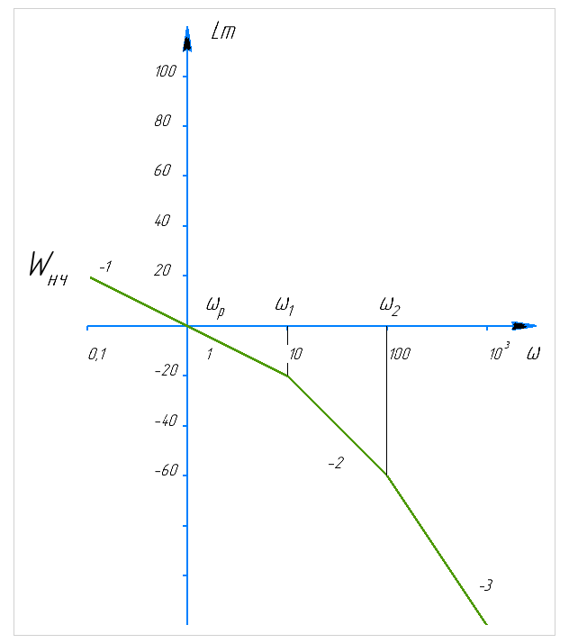
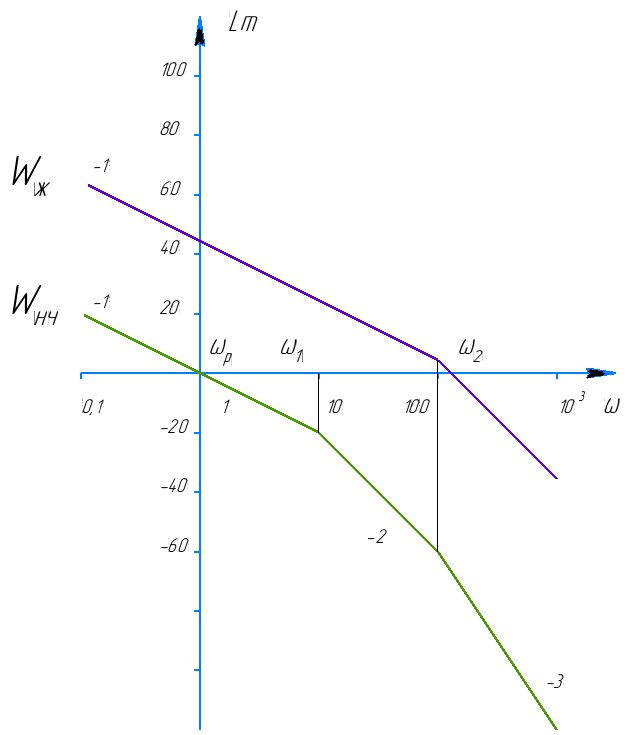

# Лабораторная работа №4. Синтез системы управления

Синтез корректирующего устройства для следящей системы и его реализация на микроконтроллере. Корректирующее устройство и дискретная модель неизменяемой части работают в прерывании таймера TIM6 с периодом 1 мс и замыкают контур; ход процесса печатается в SWV, по этим данным строятся графики и определяются перерегулирование, время переходного процесса и ошибка отработки.

Пояснения к синтезу и коду даны в главе 4 методички.

## Задание

Неизменяемая часть:

`W_НЧ = 1 / (S·(T_ЭМ·S + 1)·(T_Э·S + 1))`, T_ЭМ = 0,01 с, T_Э = 0,1 с.

| Требование                                        | Значение                         |
| ------------------------------------------------- | -------------------------------- |
| Время переходного процесса (трубка ошибки 5 %)    | t_пп ≤ 0,1 с                     |
| Перерегулирование                                 | σ ≤ 35 %                         |
| Амплитуда задающего сигнала в рабочей точке       | a = 1 В                          |
| Рабочая частота                                   | ω_р = 1 рад/с                    |
| Ошибка отработки                                  | ε ≤ 0,008 В                      |
| Постоянная составляющая входного сигнала          | b = 1,65 В                       |
| Эквивалентное входное воздействие                 | φ = a·sin(ω_р·t) + b            |

Требуется синтезировать корректирующее устройство, реализовать его на МК, построить график переходного процесса и график отработки φ(t) и определить ошибку отработки.

## Файлы

| Файл      | Что в нём                                                                                                                                                                       |
| --------- | ------------------------------------------------------------------------------------------------------------------------------------------------------------------------------- |
| `main.c`  | весь код лабораторной одним листингом: настройки, корректирующее устройство, модель неизменяемой части, `_write` для printf в SWV, `main` и обработчик таймера TIM6             |
| `images/` | рисунки к этому описанию (из методички)                                                                                                                                         |

`main.c` не заменяет файл проекта целиком: в нём нет сгенерированных CubeMX функций `SystemClock_Config`, `MX_GPIO_Init`, `MX_TIM6_Init`. Какие части куда вставлять, написано ниже в разделе «Куда вставить код».

## Результат синтеза

Требование по ошибке на рабочей частоте: `|W(jω_р)| ≥ a/ε = 1/0,008 = 125`, то есть 42 дБ. Неизменяемая часть на ω_р даёт около 0 дБ, недостающие 42 дБ набирает корректирующее устройство; с запасом взято K = 130 (42,3 дБ).



*Рисунок 21 методички. Асимптотическая ЛАЧХ неизменяемой части.*

Желаемая передаточная функция:

`W_ж(S) = 130 / (S·(0,01·S + 1)·(0,0005·S + 1))`

Полюс на 2000 рад/с (постоянная времени 0,0005 с) добавлен, чтобы корректирующее устройство было физически реализуемо (степень числителя не больше степени знаменателя), и стоит правее частоты среза (≈ 94 рад/с), потому запас по фазе остаётся около 44°.



*Рисунок 22 методички. Желаемая ЛАЧХ W_ж; ниже ЛАЧХ неизменяемой части.*

Корректирующее устройство включено последовательно с неизменяемой частью, поэтому

`ПКУ(S) = W_ж / W_НЧ = 130·(0,1·S + 1) / (0,0005·S + 1) = 26000·(S + 10) / (S + 2000)`.

Дискретизация билинейным преобразованием `S = (2/T_s)·(1 − z⁻¹)/(1 + z⁻¹)` при T_s = 1 мс (2/T_s = 2000 с⁻¹). Полюс 2000 рад/с совпадает с 2/T_s, поэтому знаменатель получается постоянным:

`ПКУ(z) = 13065 − 12935·z⁻¹`

Разностное уравнение корректирующего устройства:

`u[n] = 13065·e[n] − 12935·e[n−1]`

Модель неизменяемой части получена той же подстановкой (приведение к общему знаменателю выполнено в системе компьютерной алгебры):

`y[n] = b0·u[n] + b1·u[n−1] + b2·u[n−2] + b3·u[n−3] − a1·y[n−1] − a2·y[n−2] − a3·y[n−3]`

| b0 = b3        | b1 = b2        | a1          | a2         | a3          |
| -------------- | -------------- | ----------- | ---------- | ----------- |
| 1,18455342e-7  | 3,55366027e-7  | −2,89481166 | 2,79057095 | −0,89575930 |

Замкнутый контур в программе: `e[n] = φ[n] − y[n−1]`, то есть выход объекта берётся с прошлого такта. Это добавляет задержку T_s и уменьшает запас по фазе примерно на 5°.

Неизменяемая часть содержит интегратор, поэтому для неё `1 + a1 + a2 + a3 = 0` (полюс в точке z = 1). Если хранить коэффициенты и состояния модели в `float`, из-за округления эта сумма перестаёт быть нулём, интегратор «протекает», и ошибка отработки вырастает с 0,0078 В до 0,0093 В, то есть выходит за допуск 0,008 В. Поэтому весь контур в программе считается в `double`, а коэффициенты записаны с восемью-девятью значащими цифрами.

## Что делает программа

1. TIM6 вызывает прерывание каждую 1 мс (1 кГц).
2. В обработчике формируется задающее воздействие `phi`: при `INPUT_STEP 1` ступенька 1 В, при `INPUT_STEP 0` сигнал `A_AMP·sin(OMEGA_R·t) + B_OFF` (1·sin(t) + 1,65 В).
3. Считается замкнутый контур: `e = phi − y_1`, `u` по корректирующему устройству, `y` по модели неизменяемой части.
4. Каждые 10 мс (каждый десятый такт) печатается строка `такт,phi,y,e,u` через `printf`. Функция `_write` отправляет символы в ITM, поэтому строки видны в консоли SWV.
5. Если поставить `USE_SWV_ONLY 0`, управление `u`, ограниченное диапазоном 0…3,3 В, дополнительно выводится на DAC1 OUT1 (вывод PA4). Для проверки через SWV это не нужно.

Неизменяемая часть и задающее воздействие в этой работе вычисляются программой, поэтому внешних цепей нет: плата подключается к компьютеру только кабелем USB (ST-LINK). При `USE_SWV_ONLY 0` осциллограф подключается к PA4 (контакт A2 на разъёме CN8) и к GND.

## Настройки CubeMX

| Что                                  | Значение                                                                                              |
| ------------------------------------ | ----------------------------------------------------------------------------------------------------- |
| Плата                                | Nucleo на STM32G474RE (Board Selector); для другой платы следите за частотой                          |
| Тактирование                         | HSI → PLL (M = 4, N = 85, R = 2), SYSCLK 170 МГц                                                      |
| TIM6, Prescaler                      | 169                                                                                                   |
| TIM6, Counter Period (ARR)           | 999                                                                                                   |
| TIM6, NVIC                           | включить прерывание TIM6 (на G4 оно общее с прерыванием ошибок DAC, строка с `TIM6` и `DAC` в NVIC)    |
| SYS, Debug                           | Serial Wire (нужен для отладки и SWV)                                                                 |
| DAC1, OUT1                           | канал OUT1, выведен на внешний контакт (PA4), Output Buffer Enable, Trigger None; включить нужно в любом режиме, см. примечание ниже |

Частота таймера: 170 МГц / ((169 + 1) · (999 + 1)) = 1 кГц.

DAC1 нужен только при `USE_SWV_ONLY 0`, но включить его в CubeMX стоит и при `USE_SWV_ONLY 1`: в `main.c` стоит `extern DAC_HandleTypeDef hdac1;`, а тип `DAC_HandleTypeDef` определён только при включённом модуле HAL DAC. Если DAC не нужен совсем, закомментируйте эту строку.

Для вывода `double` через `printf` в настройках проекта включите поддержку `%f`: Project → Properties → C/C++ Build → Settings → MCU Settings, пункт «Use float with printf from newlib-nano» (то же самое, что опция линковщика `-u _printf_float`). Без неё числа с плавающей точкой в консоль не выводятся.

## Куда вставить код

Файл `main.c` в папке показывает весь код лабораторной целиком. В проект CubeIDE его части вставляются между метками `USER CODE`, остальное создаёт CubeMX:

| Что из `main.c`                                                                                                                | Куда                                       |
| ------------------------------------------------------------------------------------------------------------------------------ | ------------------------------------------ |
| `#include <math.h>`, `<stdio.h>`, `<stdint.h>`                                                                                 | `USER CODE BEGIN Includes`                 |
| настройки, константы `C_B*` и `P_*`, `extern`, `_write`, переменные состояния, `controller_step`, `plant_step`, `USE_SWV_ONLY` | `USER CODE BEGIN 0`                        |
| строка `HAL_TIM_Base_Start_IT(&htim6);` (при `USE_SWV_ONLY 0` ещё `HAL_DAC_Start(&hdac1, DAC_CHANNEL_1);`)                      | `USER CODE BEGIN 2`                        |
| `HAL_TIM_PeriodElapsedCallback`                                                                                                | `USER CODE BEGIN 4`                        |

Функцию `main` из файла копировать не нужно: у проекта она уже есть, и вызовы `HAL_Init`, `SystemClock_Config`, `MX_GPIO_Init`, `MX_TIM6_Init`, `MX_DAC1_Init` CubeMX в неё уже поставил. Строки `extern TIM_HandleTypeDef htim6;` и `extern DAC_HandleTypeDef hdac1;` можно не копировать, если эти переменные уже объявлены в `main.c` проекта.

## Просмотр данных в SWV

1. Run → Debug Configuration → Debugger: включить Serial Wire Viewer, Core Clock 170 МГц.
2. Запустить отладку, открыть Window → Show View → SWV → SWV ITM Data Console.
3. Configure Trace: включить порт 0 (ITM Stimulus Port 0), нажать Start Trace и продолжить выполнение (Resume).
4. В консоли пойдут строки `такт,phi,y,e,u`. Время в секундах равно такту, умноженному на 0,001.
5. Скопируйте строки в текстовый файл `log.csv` (только строки данных, без заголовков) и обработайте скриптом ниже или в любом другом средстве.

Для переходного процесса задайте `INPUT_STEP 1`, для отработки эквивалентного входного воздействия `INPUT_STEP 0`, пересоберите и запустите заново.

Скрипт для расчёта показателей по `log.csv` (Python с NumPy):

```python
import numpy as np

k, phi, y, e, u = np.loadtxt("log.csv", delimiter=",", unpack=True)
t = k * 1e-3                                   # время, с

# INPUT_STEP 1: переходный процесс
y_inf = y[-1]                                  # установившееся значение
sigma = (y.max() - y_inf) / y_inf * 100        # перерегулирование, %
bad = np.where(abs(y - y_inf) > 0.05 * y_inf)[0]
t_pp = t[bad[-1] + 1]                          # время, после которого y в трубке 5 %
print(f"sigma = {sigma:.1f} %, t_pp = {t_pp:.3f} с")

# INPUT_STEP 0: отработка φ(t)
eps = abs(e[t > 10]).max()                     # амплитуда ошибки в установившемся режиме
print(f"eps = {eps:.5f} В")
```

Печать идёт раз в 10 мс, поэтому время переходного процесса определяется с точностью 10 мс.

## Что должно получиться

Значения ниже получены прогоном этого кода на компьютере (скомпилирован `gcc`, обработчик вызывался 20 000 раз, арифметика `double`).

Переходный процесс (`INPUT_STEP 1`, φ = 1 В):

- первая строка вывода: `0,1.000000,0.001548,1.000000,13065.000000`, то есть `u = 13065·e` при нулевых начальных условиях, это не ошибка;
- максимум около 1,31 (перерегулирование σ ≈ 31 %, требование 35 %);
- время переходного процесса t_пп ≈ 0,07 с (требование 0,1 с);
- установившееся значение 1: ошибка порядка 10⁻⁴ В, она вызвана округлением коэффициентов модели.

Отработка эквивалентного воздействия (`INPUT_STEP 0`, φ = sin(t) + 1,65 В):

- после переходного участка (около 0,2 с) `y` повторяет `phi` в диапазоне 0,65…2,65 В;
- амплитуда ошибки в установившемся режиме около 0,0078 В (требование 0,008 В): запас небольшой, около 2 %;
- управление `u` в установившемся режиме лежит примерно в пределах −1,0…1,0 В.

## Ограничения

- Работа на плате не снималась: числа выше получены расчётом на компьютере. Данные с платы должны совпасть с ними с точностью до округления.
- Печать `printf` вызывается прямо в обработчике прерывания. Для лабораторной это удобно, в рабочей программе так не делают.
- Допуск по ошибке выдерживается с небольшим запасом, поэтому вместо `double` в модели неизменяемой части использовать `float` нельзя (см. раздел «Результат синтеза»).
